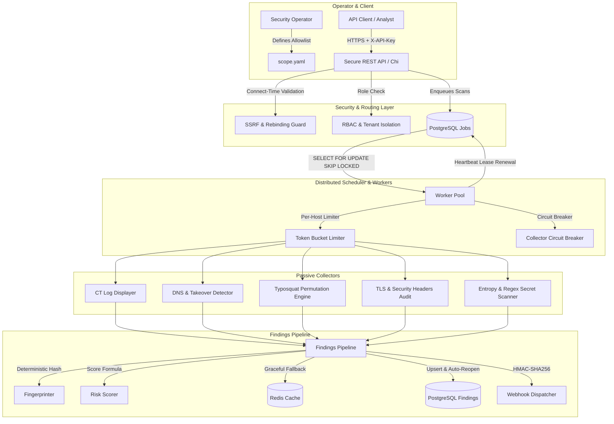

# SurfaceWatch: Attack Surface & Exposed-Secret Monitoring Platform

[](https://golang.org)
[]()
[]()
[]()

> **SurfaceWatch** is an enterprise-grade, authorized-use digital risk and attack-surface management (ASM) backend written in Go. Built for cybersecurity teams to continuously discover exposed internet assets, detect brand typosquatting, uncover dangling DNS takeovers, and scan source repositories for leaked credentials with mathematical risk scoring and zero raw-secret persistence.

---

## 1. Core Architecture

SurfaceWatch decouples collection, leasing, and pipeline processing into an asynchronous, distributed architecture backed by PostgreSQL and Redis.



---

## 2. Key Engineering Highlights

### 🛡️ Non-Negotiable Safety by Design
- **Strict Scope Guard**: Every collector checks targets against `scope.yaml` and rejects unauthorized targets with `ErrOutOfScope` before opening any network socket or file descriptor. Defends against suffix spoofing, lookalike domains, and directory traversals.
- **100% Passive Monitoring**: No port scanning, brute-forcing, or aggressive fuzzing. Only passive CT log lookups, DNS queries, TLS handshakes, HTTP response header checks, and local directory scanning.
- **Zero Raw Secrets Stored**: Exposed credentials are never persisted. SurfaceWatch stores only a cryptographically salted SHA-256 hash and a redacted preview (e.g. `AKIA...REDACTED...7FQA`).
- **SSRF Defense with Connect-Time Binding**: Outbound webhooks validate target IPs against RFC 1918, loopback, and cloud metadata (169.254.169.254) addresses *at socket connect time* (`DialContext`) to eliminate Time-of-Check to Time-of-Use (TOCTOU) DNS rebinding attacks.

### ⚙️ High-Performance Distributed Scheduler
- **Postgres Distributed Leasing (`SKIP LOCKED`)**: Workers lease jobs atomically using `SELECT ... FOR UPDATE SKIP LOCKED`. If a worker terminates abruptly, the lease expires and another worker claims it automatically.
- **Per-Host Token Bucket Rate Limiting**: Target infrastructure is never overwhelmed; requests are throttled per domain using token-bucket rate limiters.
- **Transient vs Permanent Error Classification**: Exponential backoff with full jitter automatically honors HTTP `Retry-After` on 429 errors while permanently failing 4xx client errors or scope violations.
- **Per-Collector Circuit Breakers**: Automatically halts outbound calls to failing external dependencies after threshold failures, recovering via half-open trials.

### 📊 Transparent Scoring & Deduplication
- **Deterministic Fingerprinting**: `SHA-256(finding_type | asset_value | evidence_key)` prevents duplicate findings across repeated scans.
- **Continuous Severity Formula**: Scores threat exposure from 0.0 to 100.0 ($\text{TypeWeight} \times \text{Exposure} \times \text{Confidence} \times 10.0$) with automated reopening of remediated findings if they reappear.
- **Cache Resilience**: Redis caches recent reads with a write-through invalidation strategy. If Redis fails, the system degrades gracefully with zero data loss.

---

## 3. Real Performance Benchmarks & Results

Derived on Windows 11 amd64 (13th Gen Intel Core i5-1335U, 12 vCPUs) using Go 1.23.2:

### Micro-Benchmarks (`go test -bench="." -benchmem .\internal`)
| Component | Operations | Latency | Memory / Op | Allocations |
| :--- | :--- | :--- | :--- | :--- |
| **Typosquat Permutations** (7 classes) | `4,276` | **235.82 µs/op** | 64,164 B/op | 764 allocs/op |
| **Finding Fingerprinting** (SHA-256) | `927,772` | **1.12 µs/op** | 320 B/op | 4 allocs/op |
| **Local Secret Scanner** (6 detectors + entropy) | `726` | **1.38 ms/op** | 37,200 B/op | 290 allocs/op |

### API Load Test (5,000 requests, 20 concurrent workers)
- **Throughput**: **`158.01 req/sec`**
- **Success Rate**: **100% (5,000 / 5,000 HTTP 200 OK)**
- **Median Latency (p50)**: **`23.62 ms`**
- **95th Percentile (p95)**: **`588.06 ms`**
- **99th Percentile (p99)**: **`1,785.73 ms`**

### Secret Detector Accuracy (Evaluated on Synthetic Corpus)
| Metric | Development Corpus (Seed 1337) | Holdout Corpus (Seed 9999) |
| :--- | :--- | :--- |
| **Samples Tested** | 100 (50 Pos / 50 Neg) | 100 (50 Pos / 50 Neg) |
| **Precision** | **88.89%** | **90.57%** |
| **Recall** | **96.00%** | **96.00%** |
| **F1-Score** | **0.9231** | **0.9320** |

---

## 4. Quick Start

### 4.1 Prerequisites
- Go 1.22+ installed
- Docker & Docker Compose (optional, for PostgreSQL and Redis)

### 4.2 Local Standalone Run
```bash
# 1. Clone repository
git clone https://github.com/surfacewatch/surfacewatch.git
cd surfacewatch

# 2. Run test suite with race detector
go test -race -v ./internal/...

# 3. Start the server
go run ./cmd/server -port 8080 -scope scope.yaml
```

### 4.3 Docker Compose Run
```bash
docker-compose up -d
```

### 4.4 Triggering Scans via REST API
```bash
# Check health
curl -s http://localhost:8080/healthz

# Register an asset (Admin Key required)
curl -s -X POST http://localhost:8080/api/v1/assets \
  -H "X-API-Key: sw_dev_admin_secret_token_123" \
  -H "Content-Type: application/json" \
  -d '{"type":"domain","value":"example.com"}'

# Query Findings
curl -s http://localhost:8080/api/v1/findings \
  -H "X-API-Key: sw_dev_admin_secret_token_123"
```

---

## 5. Documentation Directory
- [System Architecture](ARCHITECTURE.md)
- [Design Decisions & Scale Strategy](docs/DESIGN_DECISIONS.md)
- [Failure Modes & Verification](docs/FAILURE_MODES.md)
- [Security Threat Model](SECURITY.md)
- [Risk Scoring Model](docs/SCORING.md)
- [Honest Detector Evaluation](docs/EVALUATION.md)
- [API Load Test Methodology](docs/LOAD_TEST.md)
- [Go Idioms & Patterns Explained](docs/GO_NOTES.md)
- [15 Technical Interview Questions](docs/INTERVIEW_QUESTIONS.md)
